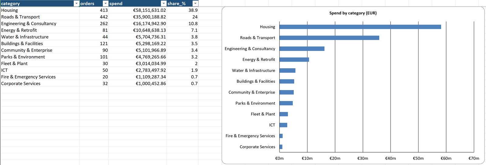
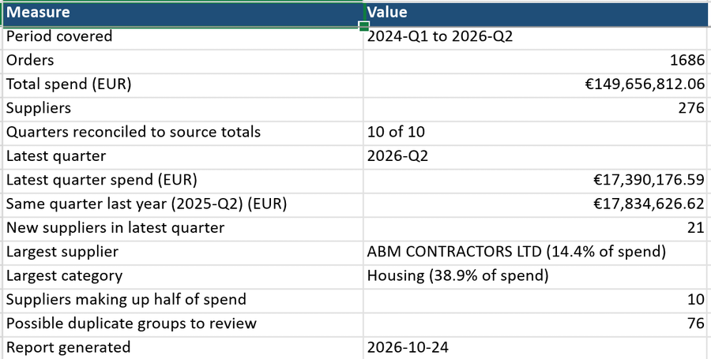

# Irish Public Spend Analysis: Wicklow County Council

**Business question:** Where does Wicklow County Council spend money on purchase orders over €20,000, who are its biggest suppliers, and how reliable is the published data?

**Data:** Wicklow County Council purchase orders over €20,000, Q1 2024 to Q2 2026 (10 quarterly .xlsx files), from [wicklow.ie](https://www.wicklow.ie/Living/Your-Council/Finance/Procurement/Purchase-Orders-Over-20-000).

**Tools:** Python 3.12 (pandas, openpyxl), Excel, Windows Task Scheduler

**Status:** Complete. The pipeline reconciles, cleans and categorises the data, builds a formatted Excel report, and runs monthly on a schedule.



## Key findings (Q1 2024 – Q2 2026)

1. **€149.7m across 1,686 orders, fully reconciled.** Every quarter matches the council's published totals to the cent.
2. **Housing and roads take almost two thirds of spend:** Housing €58.2m (38.9%), Roads & Transport €35.9m (24.0%). ICT, Fire & Emergency and Corporate Services together account for under 4%.
3. **Spend is concentrated:** 10 of 276 suppliers received half of all spend. The largest, ABM Contractors, received €21.6m (14.4%) for housing construction.
4. **Year-end spending:** Q4 is roughly three times Q1 in both full years (€22.9m vs €8.0m in 2024; €23.9m vs €7.9m in 2025).
5. **Data-quality issues found and handled:** a possible €321k double entry flagged for review, 76 groups of repeated orders (mostly recurring contracts), and a published tab containing personal data, which was excluded and removed.

### Further detail

- **Latest quarter (2026-Q2): €17.4m, 2.5% below 2025-Q2 (€17.8m), but the mix shifted.** Housing rose €3.7m, while Water & Infrastructure (−€1.8m), Roads & Transport (−€1.4m) and Engineering & Consultancy (−€1.3m) fell. 21 suppliers appeared for the first time. 2026-Q1 was 51% above 2025-Q1 (€11.9m vs €7.9m).
- **Housing construction** alone is €45.8m, the largest single description.
- **Most repeated orders are recurring contracts, not errors.** The extra copies in the 76 flagged groups are worth €4.67m. Most follow contract patterns: monthly homeless support payments and quarterly parking and engineering fees. One engineering order of €24,215.63 appears in all 10 quarters.
- **The possible double entry:** €320,854.73 to PFH Technology Group for ICT infrastructure, entered twice in 2024 Q2. It only became visible after supplier names and descriptions were cleaned.

## Skills demonstrated

- **Python and pandas:** combining files, groupby and pivot tables, text cleaning with regular expressions, fuzzy matching
- **Data quality:** reconciliation to source totals, duplicate flagging, rule-based standardisation, a documented data-quality log
- **Excel reporting:** a formatted multi-tab workbook with charts, built with openpyxl
- **Automation:** input validation, exit codes, logging and a scheduled monthly run
- **Judgement and governance:** reviewed supplier matches, category rules kept in editable files, personal data identified and removed

## The report

`py src\report.py` writes `output/wicklow_spend_report_<latest quarter>.xlsx`, a formatted workbook with charts:



| Tab | Contents |
|---|---|
| Summary | Headline measures: period, orders, spend, suppliers, reconciliation status, latest quarter vs the same quarter last year |
| Latest Quarter | Spend by category: latest quarter vs the previous quarter and the same quarter last year |
| New Suppliers | Suppliers that appear for the first time in the latest quarter |
| By Quarter | Orders and spend per quarter, with a chart |
| Top Suppliers | Top 20 suppliers with share and cumulative share of spend, with a chart |
| By Category | Spend across 12 categories, with a chart |
| By Description | Every description, its category and spend |
| Duplicates to Review | Groups of identical orders in the same quarter and the value at stake |
| Data Quality Log | Rows rejected, fixed and flagged, and why |
| Reconciliation | Calculated vs published total for every quarter |
| All Orders | Every cleaned order with its original supplier name and source file |

## Method

1. **Load:** read Sheet1 of each quarterly file and keep the three published columns.
2. **Reconcile:** each file ends with a TOTAL row (an Excel SUM). Counting it as an order would double every quarter, so it is removed from the orders and used to check that the order rows add up to the council's total.
3. **Clean descriptions:** strip leading, trailing and double spaces, then standardise capital letters to the most common spelling (e.g. "Legal fees" → "Legal Fees").
4. **Clean supplier names:** rules (`&` → `AND`, `LIMITED` → `LTD`, `TA` → `T/A`, punctuation removed), then a reviewed alias file (`data/supplier_aliases.csv`) for matches that rules cannot catch. Fuzzy matching suggested candidate pairs; each was judged by hand.
5. **Categorise:** each description is matched against keyword rules in `data/category_rules.csv`, top to bottom, and the first match sets one of 12 categories (e.g. any description containing "footpath" → Roads & Transport). Rule order settles overlaps: "fire" comes before "vehicle", so fire engines count as Fire & Emergency. Descriptions that match no rule are labelled Uncategorised and counted in the data-quality log.
6. **Flag duplicates:** there is no PO number or date, so identical rows (same quarter, supplier, amount and description) cannot be proven to be errors. They are flagged for review and kept in the totals.
7. **Report:** pandas writes the tables; openpyxl adds formatting and charts.

## Running it for a new quarter

Wicklow publishes each quarter about six weeks after it ends. To update the report:

1. Download the quarter's .xlsx file into `data/raw/`, named `YYYY_QN.xlsx` (e.g. `2026_Q3.xlsx`).
2. Run `py src\report.py`.

The script finds the newest quarter itself, writes a new file (`wicklow_spend_report_2026-Q3.xlsx`) without overwriting earlier reports, and compares the new quarter with the previous one and the same quarter a year earlier. No code changes are needed.

Built-in checks (`src/checks.py`):

| Check | When | If it fails |
|---|---|---|
| File named like `2026_Q3.xlsx` | Before loading | Stops: no report is written |
| No Excel lock file (`~$...`) in the folder | Before loading | Stops |
| Each file has a Sheet1 with Supplier, EURO and Description columns | Before loading | Stops |
| Every quarter reconciles to its TOTAL row | After the report is built | Warning |
| Exactly one TOTAL row per file | After the report is built | Warning |
| Every description matches a category rule | After the report is built | Warning, listing the new descriptions |

Blocking problems exit with code 1, so a scheduler can tell a failed run from a successful one. Tested by adding a wrongly named file (run stopped with a clear message) and by temporarily removing 2026_Q2 (a complete 2026-Q1 report was produced).

## Scheduled monthly run

`run_report.bat` runs the report without opening a terminal or activating the virtual environment, and appends everything it prints to `logs/run_log.txt` (not committed):

```
==== Run started 24/10/2026 20:44:16.24 in C:\Projects\irish-public-spend-analysis ====
Report written: output\wicklow_spend_report_2026-Q2.xlsx
...
All checks passed.
Exit code: 0
```

It changes to its own folder first (`cd /d "%~dp0"`), because Task Scheduler starts programs in `C:\Windows\System32`, and it exits with Python's own exit code, so the scheduler's "Last Result" shows whether the report actually succeeded.

To schedule it for 09:00 on the 1st of every month (Windows):

```powershell
schtasks /Create /TN "Wicklow Spend Report" /TR "C:\Projects\irish-public-spend-analysis\run_report.bat" /SC MONTHLY /D 1 /ST 09:00
```

Then, in Task Scheduler, open the task and:

- **Conditions** tab: untick *Start the task only if the computer is on AC power*. By default Windows queues the task on a laptop running on battery, so it silently never runs.
- **Settings** tab: tick *Run task as soon as possible after a scheduled start is missed*, so a month is not skipped if the computer was off.

Downloading each new quarter from wicklow.ie stays manual: the council's file links change every quarter, so automating the download would be fragile.

**Lesson learned:** the first scheduled test reported success (`Last Result: 0`) but produced nothing. Two causes: the task was queued because the laptop was on battery, and the batch file's last command was an `echo`, which always returns 0. Checking the log and the report's timestamp, rather than trusting the status, exposed both. The batch file now passes Python's exit code back to the scheduler.

## Data quality log

| Action | Issue | Rows |
|---|---|---|
| Rejected | TOTAL row at the bottom of each file (used for reconciliation) | 10 |
| Rejected | Hidden "HM old FW" tab in 2024 Q3 (see data notes) | 26 |
| Fixed | Description spacing or capital letters standardised | 1,197 |
| Fixed | Supplier name standardised by rules or alias file | 545 |
| Flagged, kept | Description matched no category rule | 0 |
| Flagged, kept | Row belongs to a possible duplicate group | 197 |

Most fixes are cosmetic: invisible trailing spaces from hand-typed spreadsheets, and legal-form spellings. Only 2 supplier names were merged with another supplier (ESB Networks, PFH Technology Group). Each individual supplier is otherwise spelled consistently by the council.

## Data notes

- All 10 files share three columns (Supplier, EURO, Description), but header casing varies between quarters.
- There is no order date or PO number, so the quarter comes from the filename and duplicates can only be flagged, not confirmed.
- The 2024 Q3 file, as published, has a second tab ("HM old FW") of internal invoice notes: negative amounts against a retired housing maintenance framework, plus staff names and tenants' home addresses. It is not part of the purchase order list, so it is excluded from the analysis. For privacy, it has been removed from the copy in this repo, and that file's TOTAL formula was saved as its value.
- The 2026 Q1 file has stray blank columns beyond column C; only Supplier, EURO and Description are used.
- Supplier names are kept at legal-entity level. Two new suppliers in 2026-Q2, Tetra Tech Consulting Ltd and Tetra Tech Ireland Ltd, may belong to the same group (Tetra Tech also acquired RPS, an existing supplier), but they are kept separate until checked against the Companies Registration Office. Grouping by parent company would need a separate mapping.
- The 173 distinct descriptions include different words for the same work (e.g. "Energy Retrofit" and "Energy Retrofit Works") and typos ("Footpath Maintenannce"); the category rules group these together.

## Setup

Requires Windows with [Python 3.12](https://www.python.org/downloads/) and [Git](https://git-scm.com/downloads) installed. Library versions are pinned in `requirements.txt` (pandas 3.1.0, openpyxl 3.1.5).

```powershell
git clone https://github.com/Ayoola-droid/irish-public-spend-analysis.git
cd irish-public-spend-analysis
py -m venv .venv
.venv\Scripts\Activate.ps1
py -m pip install -r requirements.txt
```

If PowerShell says "running scripts is disabled on this system", run this once and then activate again:

```powershell
Set-ExecutionPolicy -Scope CurrentUser RemoteSigned
```

Run the scripts from the project folder:

| Script | What it does |
|---|---|
| `py src\report.py` | **Main script:** checks the input files, then builds the formatted Excel report in `output/` |
| `.\run_report.bat` | Runs `report.py` with the project's virtual environment and logs the output to `logs/run_log.txt` (used by the scheduled task) |
| `py src\combine.py` | Loads all quarters and prints the reconciliation against each file's TOTAL row |
| `py src\suppliers.py` | Prints supplier counts, the top 10 suppliers and spend concentration |
| `py src\categories.py` | Prints spend by category and lists the descriptions in each category for review |
| `py src\quality.py` | Prints duplicate groups, orders recurring across quarters and description variants |
| `py src\inspect_raw.py` | Previews the first rows of each raw file to check headers and layout |

## Project structure

- `data/raw/`: council files as published (except the personal-data tab removed from 2024 Q3)
- `data/supplier_aliases.csv`: reviewed supplier-name matches
- `data/category_rules.csv`: keyword rules that map descriptions to categories
- `src/combine.py`: load, reconcile and clean descriptions (`load_all()`)
- `src/suppliers.py`: supplier-name standardisation (`add_supplier_clean()`)
- `src/categories.py`: spend categories (`add_category()`)
- `src/quality.py`: duplicate and consistency checks
- `src/checks.py`: input-file checks and post-run warnings
- `src/report.py`, `src/excel_format.py`: build and format the Excel report
- `run_report.bat`: runner for the scheduled monthly task
- `docs/`: README images
- `output/`, `logs/`: generated reports and run logs (not committed)
